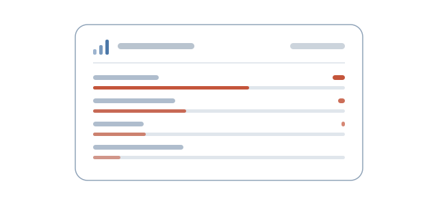

# Model request statistics for every session

The composer shows one extra reading per session: `Requests N · Failed M · Overall X tok/s`. Select it to open the panel.

## Why another tok/s?

The built-in speed divides output tokens by the decode window (first token → message). Everything before the first token — connecting to the model, queueing, backoff after a timeout, a failed attempt that was retried — is excluded, so the number reads higher than the request actually cost.

**Overall speed** divides all output tokens by each request's full wall time (`step/start` → the step's last model settle). A slow connection or a retry storm shows up in the number.

## What the panel shows

- Attempts, completed, failed, cancelled, failure rate
- Model time, output tokens, overall speed, retries
- Failure reasons ranked by count, with proportional bars (provider code + HTTP status)
- The latest failure with its time and message
- A failure whose reason never reached the log is counted as "Reason not recorded"

## Privacy and durability

Everything folds from the open session's durable event log. The plugin adds no model request, no network call, and no write to the session. Figures survive reloads, resume, paging and compaction.
