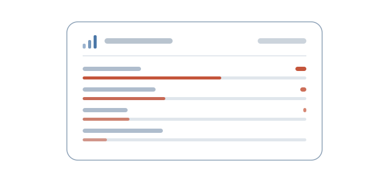

# 每个会话的模型请求统计

输入框下方的停靠栏多一个读数：「访问 N · 失败 M · 整体 X tok/s」，点击展开面板。

## 为什么还要一个 tok/s？

内置速度用「首个 token → 消息」的解码窗口做分母，连接模型、排队、超时后的退避与失败重试全都被排除，读数因此比真实成本偏高。

**整体速度**用全部输出 tokens 除以每次请求的完整耗时（`step/start` → 该步最后一次模型落定）。连接慢或重试多，读数就会体现出来。

## 面板内容

- 访问、成功、失败、已取消、失败率
- 模型耗时、输出 tokens、整体速度、重试次数
- 按次数排序的失败原因与比例条（提供方错误码 + HTTP 状态）
- 最近一次失败的时间与消息
- 日志中无原因的失败归入「未记录原因」，不做推测

## 隐私与持久性

所有数字只来自当前会话的持久事件日志；插件不发起模型请求、不发起网络调用、不写会话。刷新、恢复、翻页与压缩都不会改变统计结果。
